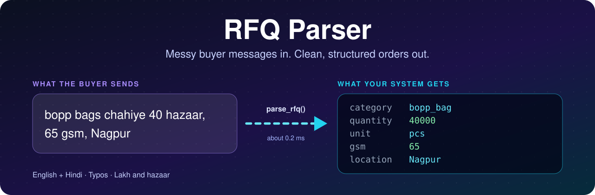
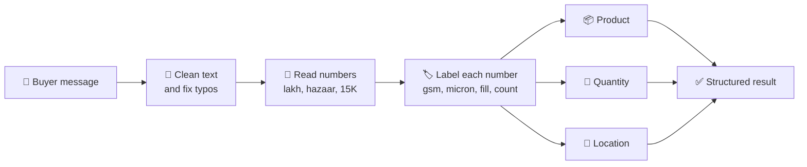

<div align="center">



<br>


**[What it does](#-what-it-does-in-30-seconds)  ·  [Demo](#-live-demo)  ·  [Try it](#-try-it-in-60-seconds)  ·  [Results](#-results)  ·  [How it works](#-how-it-works)  ·  [Glossary](#-glossary)**

</div>

<br>

## 👋 What it does, in 30 seconds

Imagine a shop that sells packaging. Buyers send quick messages like this:

> 💬 *"bopp bags chahiye 40 hazaar, 65 gsm, Nagpur"*
>
> **In plain English:** "I need 40,000 BOPP bags, 65 GSM thickness, delivered to Nagpur."

A person understands that instantly, but software can't use it until it's organised. **RFQ Parser reads the message and fills in the order details automatically**, so the buyer can be matched with the right suppliers.

| 📦 Product | 🔢 Quantity | 📏 Unit | 🧵 GSM | 📐 Micron | 📍 Location |
|:---:|:---:|:---:|:---:|:---:|:---:|
| BOPP bag | 40,000 | pieces | 65 | not stated | Nagpur |

<div align="center">

### 📊 At a glance

| **64 / 64** | **62 / 62** | **14,996 / 15,000** | **~0.2 ms** |
|:---:|:---:|:---:|:---:|
| main test set | separate test set | random stress test | per message |

<sub>Exact match on all six fields, using test sets written for this project. See <a href="#-results">Results</a> for what that does and doesn't prove.</sub>

</div>

## 🎬 Live demo

The animation replays real output from the parser. The purple line shows how it understood each number, and the green line is the final answer.



## 🪤 Why this is harder than it looks

| Buyer writes | The trap | ✅ Parser's answer |
|---|---|---|
| `jumbo bag 1000 kg capacity, 500 pcs, Vadodara` | 1000 kg is the size of each bag, not the order | **500 pieces**, Vadodara |
| `cement bag 2.5 lac chahiye 50 kg, Indore` | "lac" means 100,000, and 50 kg is what each bag holds | **2,50,000 pieces**, Indore |
| `corugated box 1,50,000 pcs deliver to Surat` | Spelling mistake and Indian number commas | **Corrugated box**, **1,50,000 pieces** |
| `dedh lakh pouch chahiye Ahmedabad` | "dedh lakh" is Hindi for one and a half lakh | **1,50,000 pieces**, Ahmedabad |
| `need quote for 500 kg shrink wrap 25 mic` | "mic" is short for micron | **500 kg** of film, **25 micron** |
| `stretch film 20 ton Kenya ke liye` | Tonnes, and a location outside India | **20 tonnes**, Kenya |

## 🚀 Try it in 60 seconds

You need [Python 3.10 or newer](https://www.python.org/downloads/).

```bash
# 1. Download the project
git clone https://github.com/upendra8690/kypson-rfq-parser.git
cd kypson-rfq-parser

# 2. Install the one dependency
pip install -r requirements.txt

# 3. Try your own message
python parse.py "bopp bags chahiye 40 hazaar, 65 gsm, Nagpur"

# 4. Run the tests
python score.py my_tests.jsonl
```

Or use it in your own Python code:

```python
from parse import parse_rfq

parse_rfq("jumbo bag 1000 kg capacity, 500 pcs, Vadodara")
# {'category': 'fibc', 'quantity': 500, 'unit': 'pcs', 'gsm': None, 'micron': None, 'location': 'Vadodara'}
```

## 🧠 How it works

**In simple terms**, it reads a message the way a careful salesperson would:

1. 🧹 **Clean up** the text and fix spelling mistakes.
2. 🔢 **Find every number** and convert words like "40 hazaar" into 40,000.
3. 🏷️ **Work out what each number means** from the words around it: quantity, weight per bag, thickness or something else.
4. 📦 **Identify the product** from keywords, with specific terms beating general ones.
5. 📍 **Find the delivery place** using a list of about 6,500 Indian towns plus world cities and countries.



**Why rules instead of an AI model?** The same message always gives the same answer, every decision can be traced with `--explain`, and it needs no paid service or API key. The trade-off is that rules only handle patterns they were written for.

<details>
<summary><b>🔧 Technical details</b></summary>

<br>

| Step | Function | What happens |
|:---:|---|---|
| 1 | `_normalise` | Handles unicode and splits glued tokens such as `65gsm`, `Rs.8` and `µ` |
| 2 | `_tokenise` | Splits words, numbers and punctuation, keeping original casing for locations |
| 3 | `_fix_typo` | Uses an alias table and edit distance against the product vocabulary |
| 4 | `_read_numbers` | Merges `1,50,000`, `2.5 lac`, `15K`, `dedh lakh` and `fifty thousand` into one value |
| 5 | `_label_numbers` | Labels each number as gsm, micron, size, ply, price, date, pincode, weight, count or bare |
| 6 | `_category` | Scores weighted keyword rules |
| 7 | `_pick_quantity` | Drops fill weights, then picks cued quantity > count > order weight > bare number |
| 8 | `_location` | Scores GeoNames matches using cues such as "deliver to" and "... mein" |

</details>

## 📈 Results

| Test | Messages | Exact match |
|---|:---:|:---:|
| ✅ `my_tests.jsonl`: every product, Hinglish, typos and traps | 64 | **64 / 64** |
| ✅ `heldout_tests.jsonl`: different style and places | 62 | **62 / 62** |
| ✅ `stress_test.py`: random messages with 669 towns not in `my_tests` | 15,000 | **14,996 / 15,000** |
| 📌 `known_failures.jsonl`: failures kept on purpose as documentation | 3 | **0 / 3** |

**Speed:** about 0.6 s for the first call, including loading the place data, then about 0.2 ms per message on a laptop CPU.

> [!IMPORTANT]
> **How to read these scores:** the tests and labels were written for this project with AI help, so real buyer messages will probably score lower. The included `score.py` is a strict stand-in, because the original scorer wasn't in the copy of the brief I received.

<details>
<summary><b>🔁 Reproduce these results</b></summary>

<br>

```bash
python score.py my_tests.jsonl
python score.py heldout_tests.jsonl
python score.py known_failures.jsonl
python stress_test.py 5000 7
python stress_test.py 5000 42
python stress_test.py 5000 123
```

</details>

## ⚠️ What it gets wrong

Knowing where it fails matters as much as knowing where it works.

| Message | It says | It should say | Why |
|---|---|---|---|
| `20 bundles of 500 bags woven sacks Rajkot` | 20 | 10,000 | It doesn't multiply bundles by bags |
| `need 10000 boxes and 5000 pouches, Pune` | Pouch | Corrugated box | The output holds only one product |
| `10 lac woven bags 50 kg chahiye UP mein` | No location | Uttar Pradesh | "UP" is also an ordinary word |

## 🗺️ What's next

- [ ] Recognise state abbreviations such as UP and MP
- [ ] Multiply packing units such as "20 bundles of 500"
- [ ] Split messages that ask for more than one product
- [ ] Tune the rules using real labelled buyer messages
- [ ] Add a small local model only where it beats the rules on a fixed test set
- [ ] Log low-confidence results and monitor them in production

## 📖 Glossary

| Term | Meaning |
|---|---|
| **RFQ** | Request for Quotation: a buyer asking suppliers for a price |
| **Lakh / lac** | 100,000 |
| **Hazaar** | Hindi for thousand |
| **Dedh lakh** | One and a half lakh, or 150,000 |
| **Chahiye** | Hindi for "needed" |
| **GSM** | Grams per square metre, a measure of how heavy a material is |
| **Micron** | One-thousandth of a millimetre, used for film thickness |
| **BOPP** | Biaxially oriented polypropylene, a plastic film used on bags |
| **FIBC** | Flexible intermediate bulk container, also called a jumbo or bulk bag |
| **Mono carton** | A single-layer folding paperboard box |
| **Woven sack** | A strong bag woven from plastic strips, often used for cement |

## 📁 What's in this repo

```text
├── parse.py               # The parser: parse_rfq(text) -> dict
├── score.py               # Stand-in scorer with strict exact matching
├── stress_test.py         # Random message generator for robustness checks
├── my_tests.jsonl         # 64 labelled messages
├── heldout_tests.jsonl    # 62 messages in a different style
├── known_failures.jsonl   # 3 documented failures
├── NOTE.md                # Approach, trade-offs and next steps
├── requirements.txt       # geonamescache==3.0.2
└── assets/                # README graphics
```

## 🤝 Built with

- 🐍 **Python 3.10+** and its standard library
- 🌍 **[geonamescache](https://pypi.org/project/geonamescache/)** for GeoNames place data
- 🤖 **Claude (Anthropic)** as an AI coding assistant. [NOTE.md](NOTE.md) explains what it did and what I checked myself.

<br>

<div align="center">

**Built by [Mopuru Upendra Reddy](https://github.com/upendra8690)** as a pre-interview assignment for Kypson Solutions.

⭐ If you found this useful, consider giving it a star.

</div>
