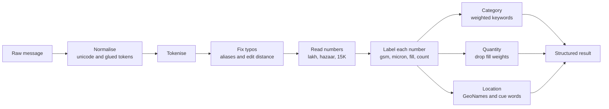

<div align="center">

# 📦 RFQ Parser

### Turn messy Hinglish packaging enquiries into clean, structured data.

**Fast · Deterministic · Fully offline · No API keys**


[Demo](#-see-it-work) · [Quick start](#-quick-start) · [How it works](#-how-it-works) · [Results](#-results) · [Limitations](#-known-limitations)

</div>

---

## 💡 The problem

Buyers on a B2B packaging marketplace don't fill in forms. They send messages like this:

> *bopp bags chahiye 40 hazaar, 65 gsm, Nagpur*

Before a buyer can be matched with suppliers, that text has to become structured data, despite mixed English and Hindi, typos, Indian number formats, and weights that look like order quantities.

`parse_rfq()` handles this with one function call:

```python
>>> from parse import parse_rfq
>>> parse_rfq("bopp bags chahiye 40 hazaar, 65 gsm, Nagpur")
{'category': 'bopp_bag', 'quantity': 40000, 'unit': 'pcs', 'gsm': 65, 'micron': None, 'location': 'Nagpur'}
```

## 🎯 See it work

Each row is real output from `parse.py`. Fields that come back empty are left out to keep the table readable.

| Buyer's message | What makes it hard | Parsed result |
|---|---|---|
| `bopp bags chahiye 40 hazaar, 65 gsm, Nagpur` | Hinglish number word | `bopp_bag` · 40,000 pcs · 65 gsm · Nagpur |
| `jumbo bag 1000 kg capacity, 500 pcs, Vadodara` | Capacity is not the order size | `fibc` · 500 pcs · Vadodara |
| `need quote for 500 kg shrink wrap 25 mic` | "mic" means micron | `film` · 500 kg · 25 micron |
| `cement bag 2.5 lac chahiye 50 kg, Indore` | Lakh amount plus a fill weight | `woven_sack` · 2,50,000 pcs · Indore |
| `corugated box 1,50,000 pcs deliver to Surat` | Typo and Indian comma format | `corrugated_box` · 1,50,000 pcs · Surat |
| `dedh lakh pouch chahiye Ahmedabad` | "dedh lakh" means 1.5 lakh | `pouch` · 1,50,000 pcs · Ahmedabad |
| `stretch film 20 ton Kenya ke liye` | Tonnes and a foreign location | `film` · 20 mt · Kenya |

## ✨ What it handles

| Challenge | Examples |
|---|---|
| **Indian number formats** | `1,50,000` · `2.5 lac` · `15K` · `40 hazaar` · `dedh lakh` · `sawa lakh` |
| **Number words** | `fifty thousand` · `2 lakh 50 thousand` |
| **Typos** | `corugated` · `flim` |
| **Glued text and symbols** | `65gsm` · `Rs.8` · `µ` |
| **Fill-weight traps** | `25 kg bag` · `1000 kg capacity` are not treated as the order quantity |
| **Unseen places** | About 6,500 Indian towns plus world cities, countries and states from GeoNames |

**Output categories:** `bopp_bag` · `woven_sack` · `corrugated_box` · `pouch` · `film` · `mono_carton` · `fibc`

## 🚀 Quick start

```bash
git clone https://github.com/upendra8690/kypson-rfq-parser.git
cd kypson-rfq-parser
pip install -r requirements.txt

# Parse one message
python parse.py "bopp bags chahiye 40 hazaar, 65 gsm, Nagpur"

# See how each number was understood
python parse.py --explain "jumbo bag 1000 kg capacity, 500 pcs, Vadodara"

# Run the test set
python score.py my_tests.jsonl
```

The `--explain` flag shows the role given to each number:

```text
jumbo bag [1000 -> fill] kg capacity [500 -> count] pcs vadodara
  => {"category": "fibc", "quantity": 500, "unit": "pcs", "gsm": null, "micron": null, "location": "Vadodara"}
```

## 🧠 How it works

The parser uses fixed rules, with no machine learning and no network calls, so the same message always gives the same result and every decision can be traced.



The hardest field is quantity, because a message can contain several numbers. Fill weights and capacities are removed first, then the parser picks in this order:

```text
number marked as quantity  >  count with a unit  >  order weight  >  largest bare number
```

## 📊 Results

| Test set | Messages | Exact match on all six fields |
|---|---:|---:|
| `my_tests.jsonl` | 64 | **64 / 64** |
| `heldout_tests.jsonl` (different style and places) | 62 | **62 / 62** |
| `stress_test.py` (seeds 7, 42 and 123, with 669 towns not in `my_tests`) | 15,000 | **14,996 / 15,000** |
| `known_failures.jsonl` (documented failures) | 3 | **0 / 3**, as expected |

**Speed:** about 0.6 s for the first call, including loading the place data, then about 0.2 ms per message on a laptop CPU.

> [!NOTE]
> These tests and their labels were written for this project with AI help, so expect a lower score on unseen real-world messages. The included `score.py` is a stand-in with strict exact matching, because the original scorer wasn't in the copy of the brief I received.

Reproduce the results:

```bash
python score.py my_tests.jsonl
python score.py heldout_tests.jsonl
python score.py known_failures.jsonl
python stress_test.py 5000 7
python stress_test.py 5000 42
python stress_test.py 5000 123
```

## ⚠️ Known limitations

| Message | Parser result | Should be | Why |
|---|---|---|---|
| `20 bundles of 500 bags woven sacks Rajkot` | quantity 20 | 10,000 | Packing units aren't multiplied |
| `need 10000 boxes and 5000 pouches, Pune` | category `pouch` | `corrugated_box` | The output holds only one product |
| `10 lac woven bags 50 kg chahiye UP mein` | no location | Uttar Pradesh | "UP" is also an ordinary word |

## 🗺️ Roadmap

- [ ] Recognise state abbreviations such as UP and MP
- [ ] Multiply packing units such as "20 bundles of 500"
- [ ] Split messages that ask for more than one product
- [ ] Tune the rules against real labelled buyer messages
- [ ] Add a small local tagger where it beats the rules on a fixed test split
- [ ] Log low-confidence parses and monitor them in production

## 📁 Project structure

```text
├── parse.py               # The parser: parse_rfq(text) -> dict
├── score.py               # Stand-in scorer with strict exact matching
├── stress_test.py         # Random message generator for robustness checks
├── my_tests.jsonl         # 64 labelled messages
├── heldout_tests.jsonl    # 62 messages in a different style
├── known_failures.jsonl   # 3 documented failures
├── NOTE.md                # Approach, trade-offs and next steps
└── requirements.txt       # geonamescache==3.0.2
```

## 🤝 Built with

- **Python 3.10+** with the standard library
- **[geonamescache](https://pypi.org/project/geonamescache/)** for GeoNames place data
- **Claude (Anthropic)** as an AI coding assistant. See [NOTE.md](NOTE.md) for what it did and what I checked myself.

---

<div align="center">

Built by **[Mopuru Upendra Reddy](https://github.com/upendra8690)** as a pre-interview assignment for Kypson Solutions.

</div>
